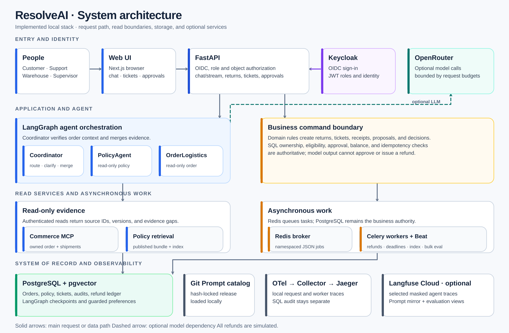
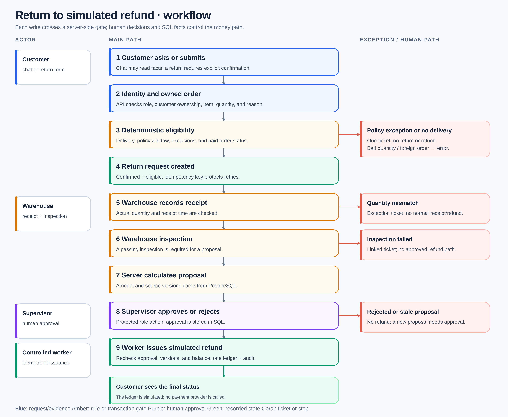

# ResolveAI system structure and workflow

> Source-level view checked against the implemented code and Compose configuration on 2026-10-11. These diagrams describe the runnable development system, not every target in the [v6 plan](../../plans/resolveai-v6.md). Rebuild the containers to run the latest checked-out code.

## System at a glance

[Open the scalable architecture image](system-overview.svg) · [Editable SVG renderer](render_diagrams.py)

The web application is the entry point for four roles. Keycloak provides browser sign-in and signed OIDC tokens in the full local stack. FastAPI validates the token, role, and ownership of each order or ticket. The local mock mode uses explicit development actor headers and is limited to loopback use.

FastAPI serves both the **agent conversation** and **protected business commands**. The LangGraph coordinator routes a question, asks for missing details, and merges current evidence. Its PolicyAgent reads the selected published policy bundle; its OrderLogisticsAgent reads an owned order and shipment through the authenticated, read-only Commerce MCP. In `collab` mode, independent evidence tasks can run in parallel; `single` mode gathers the same kinds of facts sequentially. Both modes validate source IDs, versions, and conflicts before answering. The agent cannot approve or issue a refund.

The domain services are the authority for customer ownership, return eligibility, warehouse facts, proposals, supervisor decisions, balance, and idempotency. PostgreSQL stores the business record, audit events, policy search index, LangGraph checkpoints, and guarded customer preferences. Redis carries namespaced Celery jobs; it does not hold the authoritative refund state. Beat schedules refund issuance, deadline checks, and policy indexing. A separate bulk worker handles synthetic generation and development evaluations.

| Boundary | Responsibility | Source |
|---|---|---|
| Browser and identity | Role-specific UI; Keycloak authorization-code login with PKCE | [web app](../../apps/web/app/page.tsx), [auth](../../apps/api/resolveai/auth.py) |
| HTTP/API | Role and object checks; chat, returns, warehouse, proposals, tickets, profile, policy endpoints | [FastAPI routes](../../apps/api/resolveai/api.py) |
| Agent | Coordinator, two read-only specialist graphs, evidence merge and bounded replanning | [agent graph](../../apps/api/resolveai/agent.py) |
| Read tools | Customer-scoped order and shipment reads; published policy retrieval | [Commerce MCP](../../services/commerce_mcp/server.py), [policy retriever](../../apps/api/resolveai/policy_retrieval.py) |
| Business writes | Eligibility, return, inspection, proposal, approval, refund and audit rules | [domain services](../../apps/api/resolveai/domain.py) |
| Persistent state | PostgreSQL business rows and checkpoints; guarded preference memory | [models](../../apps/api/resolveai/models.py), [checkpoint](../../apps/api/resolveai/checkpoint.py), [memory](../../apps/api/resolveai/memory.py) |
| Background work | Redis/Celery refund and deadline tasks, policy indexing, bulk jobs | [jobs](../../apps/api/resolveai/jobs.py), [worker](../../apps/api/resolveai/worker.py) |
| Deployment | Local PostgreSQL, API, web, workers, MCP, Keycloak profile, Collector, Jaeger | [Compose](../../infra/compose/compose.yaml) |

### Model, Prompt, and trace paths

The agent reads only hash-verified, versioned [local Prompt releases](../../prompts/releases/) from the [catalog](../../prompts/catalog/). When an OpenRouter key is configured, the model adapter can perform structured intent, planning, and bounded evidence review. With no key, deterministic mock logic provides the development path. The model registry and request budget bound model selection, calls, tokens, time, and per-request cost; model text never grants business authority. See the [model adapter](../../apps/api/resolveai/openrouter.py), [model registry](../../apps/api/resolveai/models_config.py), and [request budget](../../apps/api/resolveai/request_budget.py).

OpenTelemetry sends local spans through the Collector to Jaeger. Selected masked chat and agent spans can also go to Langfuse Cloud when configured. Langfuse is a Prompt mirror and evaluation/observability surface; runtime Prompts still come from Git. Audit events and refund ledger rows stay in PostgreSQL and are the business record. See [telemetry](../../apps/api/resolveai/telemetry.py) and the [Compose collector](../../infra/compose/otel-collector.yaml).

## Customer return to refund

[Open the scalable workflow image](return-workflow.svg)

| Step | Who or what acts | Result and gate |
|---|---|---|
| 1. Ask or submit | Customer in chat or return form | The agent may explain policy and order facts. A return write needs an explicit confirmation with order, item, quantity, and reason. |
| 2. Verify | FastAPI and domain services | Authenticate the customer; verify order ownership and the selected item. Missing or ambiguous details cause clarification. |
| 3. Decide eligibility | Domain services | Check delivery, the applicable policy window and exclusions, quantity, and paid order status. Policy exceptions, unverified delivery, outside-window requests, and unsupported order facts create an audited support ticket; they do not create a return or refund. Invalid quantity and foreign orders return an error. |
| 4. Create return | Domain services | A confirmed eligible request is stored with an idempotency key. Retrying the same request does not duplicate it. |
| 5–6. Receive and inspect | Warehouse role | Record actual received quantity and time, then a passing inspection. Mismatch or failed inspection moves to an exception/ticket path. |
| 7. Propose | Protected server action | Calculate the simulated refund from paid allocation and bind the proposal to current return, inspection, order, and policy facts. |
| 8. Decide | Supervisor role | Approve or reject the proposal. A stale proposal must be replaced and approved again. |
| 9. Issue | Controlled Celery worker | Reread SQL approval, versions, and balance, then write at most one simulated refund ledger row and audit event. There is no customer or agent refund issuance endpoint. |

Support can reply to and resolve tickets after supervisor assignment. **Ticket resolution communicates a human outcome; it does not automatically change eligibility, warehouse inspection, approval, or refund state.** The API and UI expose ticket history to the authorized customer and support actor. The [business workflow guide](../../README.md#business-workflow) lists the endpoints and UI actions.

## Running modes and current limits

- **Docker Compose with OIDC:** PostgreSQL, Keycloak, API, web, read-only MCP, Redis/Celery, Collector, and Jaeger. Set `AUTH_MODE=oidc` in the ignored local `.env`; see the [run instructions](../../README.md#containers-oidc-and-external-integrations).
- **No-key mock:** The same basic business rules and synthetic 25-order demo can run without OpenRouter or Langfuse. SQLite is available as a lightweight local fallback; PostgreSQL is the Compose primary store. See the [mock setup](../../README.md#ubuntu-setup-and-no-key-mock-run).
- **Development evaluation:** Isolated JSONL suites and database-first scorers write local reports. The latest documented minimum passed 7/7 suites, but its cases remain development data. The current [one-human packet](../HUMAN_REVIEW_HANDOFF.md) has no completed review. The original v6 two-human, independent locked release gate remains false.

The system performs **simulated** refunds only. Damaged goods, delivery and quantity disputes, complex payment splits, and policy exceptions require human handling or approved business rules. A model answer, MCP finding, Langfuse score, or trace cannot substitute for a customer confirmation, warehouse fact, supervisor decision, or SQL audit record.
